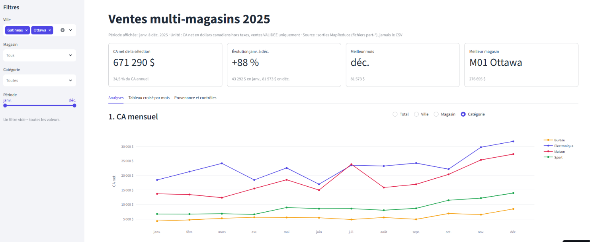

# Tableau de bord des ventes multi-magasins


Chaîne de traitement distribuée : **CSV → HDFS → MapReduce Python (Hadoop Streaming) → tableau de bord Streamlit → image Docker publiée.**

Projet d'équipe (UA2) du cours *Bases de données massives avancées* (IFM30522-0030-A2026), Collège La Cité, professeur Oussama Naciri. Remise : 9 novembre 2026.

| | |
| --- | --- |
| Dépôt | [https://github.com/lezoul/hadoop-mapreduce-ventes-multimagasins](https://github.com/lezoul/hadoop-mapreduce-ventes-multimagasins) |
| Image Docker | `docker.io/yacinelezoul/dashboard-ventes:1.0` ([page Docker Hub](https://hub.docker.com/r/yacinelezoul/dashboard-ventes)) |
| Tableau de bord en ligne | [https://hadoop-mapreduce-ventes-multimagasins.streamlit.app](https://hadoop-mapreduce-ventes-multimagasins.streamlit.app/) (Streamlit Community Cloud) |
| Données | `donnees/ventes_multimagasin_2025.csv` : 24 000 ventes de 2025, 8 magasins, 6 villes, 20 produits |
| Résultat de contrôle | CA net 2025 = **1 946 613,14 $** (194 661 314 cents), identique dans tous les jobs et toutes les configurations |

**Équipe** : Yacine Lezoul (2748526), Mouncif Bouchachi (2743259), Adel Benhamma (2741167), Rimy Meziani (2741840), Barnabe Landry Evouna (2751210), Douyeri Lamoussa Sanogo (2731042).

---

## 1. Architecture

```text
ventes_multimagasin_2025.csv  (poste local, dossier donnees/)
        │  montage Docker -v  (même dossier vu dans le conteneur sous /projet)
        ▼
hadoop-master (Ubuntu 22.04)  ── hdfs dfs -put ──►  HDFS /projet_ventes/entree   (blocs répliqués ×2)
        │                                            sur hadoop-worker1 et hadoop-worker2
        ▼
Job 1  mapper_detail.py + reducer_somme.py   CSV ──► ca_detail   (24 001 lignes ► 1 917)
Jobs 2 à 5  mapper_regroupe.py <niveau> + reducer_somme.py
        ca_detail ──► ca_mois (12) · ca_magasin (8) · ca_categorie (4) · ca_produit (20)
        │  hdfs dfs -get
        ▼
resultats/  (fichiers part-*)  ── volume Docker ──►  conteneur dashboard-ventes (Streamlit, port 8501)
```

Le cluster comporte 3 conteneurs sur le réseau Docker `reseau-hadoop`, créés à partir de l'image Hadoop fournie au laboratoire `ous1/hadoop-cluster:latest` (Ubuntu 22.04.1 LTS, Hadoop 3.3.6, Java 1.8, Python 3.10.12) :

| Conteneur | Services | Ports publiés |
| --- | --- | --- |
| `hadoop-master` | NameNode, SecondaryNameNode, ResourceManager, JobHistoryServer | 9870 (HDFS), 8088 (YARN), 19888 (historique) |
| `hadoop-worker1` | DataNode, NodeManager | 8040 → 8042 |
| `hadoop-worker2` | DataNode, NodeManager | 8041 → 8042 |

**Architecture par chaînage** : le job 1 lit le CSV une seule fois et produit `ca_detail`, dont la clé contient toutes les dimensions (`mois|magasin|ville|categorie|id_produit|nom_produit`). Les jobs 2 à 5 relisent ces 1 917 lignes et ne gardent qu'une partie de la clé. Le tableau de bord filtre et croise `ca_detail` ; les 4 autres jobs servent au contrôle de cohérence.

## 2. Structure du dépôt

```text
.
├── README.md                     # ce fichier
├── rapport.pdf                   # rapport d'évaluation (10 pages, organisé selon la grille)
├── rapport_detaille.pdf          # rapport complet : guide de reproduction, code commenté, preuves
├── presentation.pptx             # support de soutenance (12 diapositives)
├── preuve_docker.txt             # registre, image:tag, digest, sorties pull / run
├── donnees/
│   └── ventes_multimagasin_2025.csv   # données fournies (protégées par .gitattributes)
├── sources/                      # code MapReduce (exécuté sur le cluster)
│   ├── controle_qualite.py       # contrôles du CSV avant traitement (aucun calcul de CA)
│   ├── mapper_mois.py            # premier Mapper (clé = mois), job de contrôle direct
│   ├── mapper_detail.py          # job 1 : CSV -> clé détaillée, montant net en cents
│   ├── mapper_regroupe.py        # jobs 2 à 5 : clé détaillée -> mois | magasin | categorie | produit
│   └── reducer_somme.py          # Reducer unique : somme des cents par clé
├── tests/
│   ├── echantillon_test.csv      # 7 ventes piégées (remise, demi-cent, annulée, ligne abîmée)
│   ├── attendu_ca_detail.txt     # résultat calculé à la main
│   └── attendu_ca_mois.txt
├── resultats/                    # sorties MapReduce récupérées avec hdfs dfs -get
│   ├── ca_detail/ ca_mois/ ca_magasin/ ca_categorie/ ca_produit/   # part-00000 + _SUCCESS
│   └── controle_qualite.txt      # rapport du contrôle qualité
├── application_python/           # tableau de bord
│   ├── app.py                    # interface Streamlit : filtres, 4 analyses, tableau croisé, provenance
│   ├── lecture_resultats.py      # seule porte d'entrée des données : lit les part-*
│   ├── requirements.txt          # streamlit 1.66.1, plotly 7.1.0, pandas 3.1.0
│   ├── Dockerfile                # image python:3.14-slim
│   ├── .dockerignore
│   └── .streamlit/config.toml    # thème
├── scripts_execution/
│   ├── commandes_execution.md    # toutes les commandes du projet, commentées, dans l'ordre (étapes 0 à 10)
│   └── journaux/                 # sorties réelles de toutes les commandes (preuves)
└── captures/                     # captures HDFS, YARN, Docker et tableau de bord
```

## 3. Lancer seulement le tableau de bord (2 minutes)

Prérequis : Docker et Git.

```bash
git clone https://github.com/lezoul/hadoop-mapreduce-ventes-multimagasins.git
cd hadoop-mapreduce-ventes-multimagasins
docker pull yacinelezoul/dashboard-ventes:1.0
```

Linux / macOS :
```bash
docker run -d --name dashboard-ventes -p 8501:8501 -v "$(pwd)/resultats:/app/resultats:ro" yacinelezoul/dashboard-ventes:1.0
```
Windows (PowerShell) :
```powershell
docker run -d --name dashboard-ventes -p 8501:8501 -v "${PWD}\resultats:/app/resultats:ro" yacinelezoul/dashboard-ventes:1.0
```

Ouvrir http://localhost:8501. L'onglet *Provenance et contrôles* doit afficher le dossier `/app/resultats` et le bandeau vert « Les 5 jobs donnent le même total ». Arrêt : `docker rm -f dashboard-ventes`.

L'image ne contient pas les données : les sorties MapReduce lui sont données par le volume `-v`, monté en lecture seule (`:ro`) dans `/app/resultats` (variable `DOSSIER_RESULTATS`).

## 4. Reproduire toute la chaîne

> Toutes les commandes du projet, commentées et dans l'ordre, sont aussi regroupées dans [`scripts_execution/commandes_execution.md`](scripts_execution/commandes_execution.md).

Les commandes sont données pour un hôte **Ubuntu 22.04 (bash)**. Sous Windows, utiliser PowerShell : remplacer `\` en fin de ligne par `` ` `` et `$(pwd)` par `${PWD}`. Le guide détaillé, avec l'explication de chaque commande et les résultats attendus, est en annexe A du rapport détaillé (`rapport_detaille.pdf`).

**Repère** : une invite `root@hadoop-master:~#` signifie que l'on est **dans** le conteneur maître (commandes `hdfs`, `yarn`, `mapred`, `python3`) ; sinon on est sur l'hôte (commandes `docker`, `git`).

### Étape 1 : créer le cluster (hôte, depuis la racine du dépôt)

```bash
docker network create --driver bridge reseau-hadoop
docker run -itd --name hadoop-worker1 --hostname hadoop-worker1 --network reseau-hadoop -p 8040:8042 ous1/hadoop-cluster:latest
docker run -itd --name hadoop-worker2 --hostname hadoop-worker2 --network reseau-hadoop -p 8041:8042 ous1/hadoop-cluster:latest
docker run -itd --name hadoop-master  --hostname hadoop-master  --network reseau-hadoop \
  -p 9870:9870 -p 8088:8088 -p 19888:19888 \
  -v "$(pwd):/projet" ous1/hadoop-cluster:latest
```
Les noms `hadoop-worker1` et `hadoop-worker2` sont imposés par le fichier `workers` de l'image. Le volume `-v` rend le dépôt visible dans le maître sous `/projet`.

### Étape 2 : démarrer HDFS et YARN

```bash
docker exec -it hadoop-master bash
hdfs namenode -format                 # première fois seulement : efface HDFS
start-dfs.sh
start-yarn.sh
mapred --daemon start historyserver
jps                                   # NameNode, SecondaryNameNode, ResourceManager, JobHistoryServer
hdfs dfsadmin -report                 # Live datanodes (2)
yarn node -list                       # 2 noeuds RUNNING
```
Interfaces : http://localhost:9870 (HDFS) et http://localhost:8088 (YARN).

### Étape 3 : contrôler la qualité du CSV

```bash
python3 /projet/sources/controle_qualite.py /projet/donnees/ventes_multimagasin_2025.csv
```
Attendu : 24 000 lignes, 0 valeur manquante, 0 doublon d'identifiant, 334 lignes identiques hors identifiant (conservées), période 2025-01-01 au 2025-12-31.

### Étape 4 : déposer le CSV dans HDFS

```bash
hdfs dfs -mkdir -p /projet_ventes/entree /projet_ventes/entree_blocs_1m /projet_ventes/tests /projet_ventes/sorties
hdfs dfs -put /projet/donnees/ventes_multimagasin_2025.csv /projet_ventes/entree/
hdfs dfs -D dfs.blocksize=1048576 -put /projet/donnees/ventes_multimagasin_2025.csv /projet_ventes/entree_blocs_1m/
hdfs dfs -cat /projet_ventes/entree/ventes_multimagasin_2025.csv | md5sum      # 4ae57ed472eb5c10dd07814deba2c37b
hdfs fsck /projet_ventes/entree/ventes_multimagasin_2025.csv -files -blocks -locations
```

### Étape 5 : lancer les jobs MapReduce

Test local (sans Hadoop) :
```bash
python3 /projet/sources/mapper_detail.py < /projet/donnees/ventes_multimagasin_2025.csv \
  | LC_ALL=C sort | python3 /projet/sources/reducer_somme.py | awk -F'\t' '{s += $2} END {print s}'   # 194661314
```

Job 1, CSV → `ca_detail` :
```bash
mapred streaming \
  -D mapreduce.job.name="ca_detail_r1" -D mapreduce.job.reduces=1 \
  -files /projet/sources/mapper_detail.py,/projet/sources/reducer_somme.py \
  -mapper "python3 mapper_detail.py" -reducer "python3 reducer_somme.py" \
  -input /projet_ventes/entree/ventes_multimagasin_2025.csv \
  -output /projet_ventes/sorties/ca_detail/r1
```

Jobs 2 à 5, `ca_detail` → indicateurs :
```bash
for niveau in mois magasin categorie produit
do
  mapred streaming \
    -D mapreduce.job.name="ca_${niveau}_r1" -D mapreduce.job.reduces=1 \
    -files /projet/sources/mapper_regroupe.py,/projet/sources/reducer_somme.py \
    -mapper "python3 mapper_regroupe.py ${niveau}" -reducer "python3 reducer_somme.py" \
    -input /projet_ventes/sorties/ca_detail/r1 \
    -output /projet_ventes/sorties/ca_${niveau}/r1
done
```

Récupérer les sorties pour le tableau de bord :
```bash
mkdir -p /projet/resultats
for job in detail mois magasin categorie produit
do
  hdfs dfs -get /projet_ventes/sorties/ca_${job}/r1 /projet/resultats/ca_${job}
done
```

### Étape 6 : expériences (Reducers, Mappers, YARN)

```bash
# 2 puis 4 Reducers : un fichier part-* par Reducer, total inchangé
for r in 2 4; do
  mapred streaming -D mapreduce.job.name="ca_mois_r${r}" -D mapreduce.job.reduces=${r} \
    -files /projet/sources/mapper_regroupe.py,/projet/sources/reducer_somme.py \
    -mapper "python3 mapper_regroupe.py mois" -reducer "python3 reducer_somme.py" \
    -input /projet_ventes/sorties/ca_detail/r1 -output /projet_ventes/sorties/ca_mois/r${r}
done
hdfs dfs -cat /projet_ventes/sorties/ca_mois/r4/part-* | awk -F'\t' '{s += $2} END {print s}'

# Nombre de Mappers : -D mapreduce.job.maps=1 ou 4 sur entree/, et 1 sur entree_blocs_1m/ (donne 2)
yarn node -list -showDetails
yarn application -status <application_id>
```

### Étape 7 : tableau de bord en local (sans Docker)

```bash
cd application_python
python -m pip install -r requirements.txt
python -m streamlit run app.py          # http://localhost:8501
```

### Étape 8 : cas de test calculé à la main

```bash
hdfs dfs -put /projet/tests/echantillon_test.csv /projet_ventes/tests/
mapred streaming -D mapreduce.job.name="test_ca_detail" -D mapreduce.job.reduces=1 \
  -files /projet/sources/mapper_detail.py,/projet/sources/reducer_somme.py \
  -mapper "python3 mapper_detail.py" -reducer "python3 reducer_somme.py" \
  -input /projet_ventes/tests/echantillon_test.csv -output /projet_ventes/sorties/tests/ca_detail
hdfs dfs -cat /projet_ventes/sorties/tests/ca_detail/part-* | diff - /projet/tests/attendu_ca_detail.txt && echo "TEST REUSSI"
```

### Étape 9 : construire et publier l'image

```bash
cd application_python
docker build -t <compte>/dashboard-ventes:1.0 .
docker login                              # connexion par le navigateur ; ne jamais écrire de jeton dans un fichier
docker push <compte>/dashboard-ventes:1.0
```

### Arrêter le cluster

```bash
mapred --daemon stop historyserver && stop-yarn.sh && stop-dfs.sh && exit
docker stop hadoop-master hadoop-worker1 hadoop-worker2
```
Au redémarrage : `docker start hadoop-worker1 hadoop-worker2 hadoop-master`, puis `start-dfs.sh`, `start-yarn.sh` et l'historyserver dans le maître (sans reformater).

## 5. Règles de calcul

- Montant net d'une vente VALIDEE = `quantite × prix_unitaire_cad × (1 − remise_pct / 100)`.
- Arrondi au cent **par vente**, 0,5 arrondi vers le haut (`Decimal`, `ROUND_HALF_UP`), avant toute somme ; les montants circulent en cents entiers.
- Ventes ANNULEE et lignes mal formées ignorées par le Mapper.
- Le tableau de bord ne lit jamais le CSV : seulement les fichiers `part-*`.

## 6. Résultats principaux

| Indicateur | Résultat |
| --- | --- |
| CA net 2025 | 1 946 613,14 $ |
| Évolution janvier → décembre | 123 316,69 $ → 228 992,72 $ (+86 %) |
| Premier magasin | M05 Toronto, 377 268,41 $ |
| Première catégorie | Electronique, 796 377,63 $ (40,9 %) |
| Premier produit | Ecran 24 pouces, 266 676,30 $ |

## 7. Sécurité

Aucun mot de passe ni jeton n'est stocké dans le code, l'image ou le dépôt. La connexion à Docker Hub se fait de manière interactive (`docker login`).
